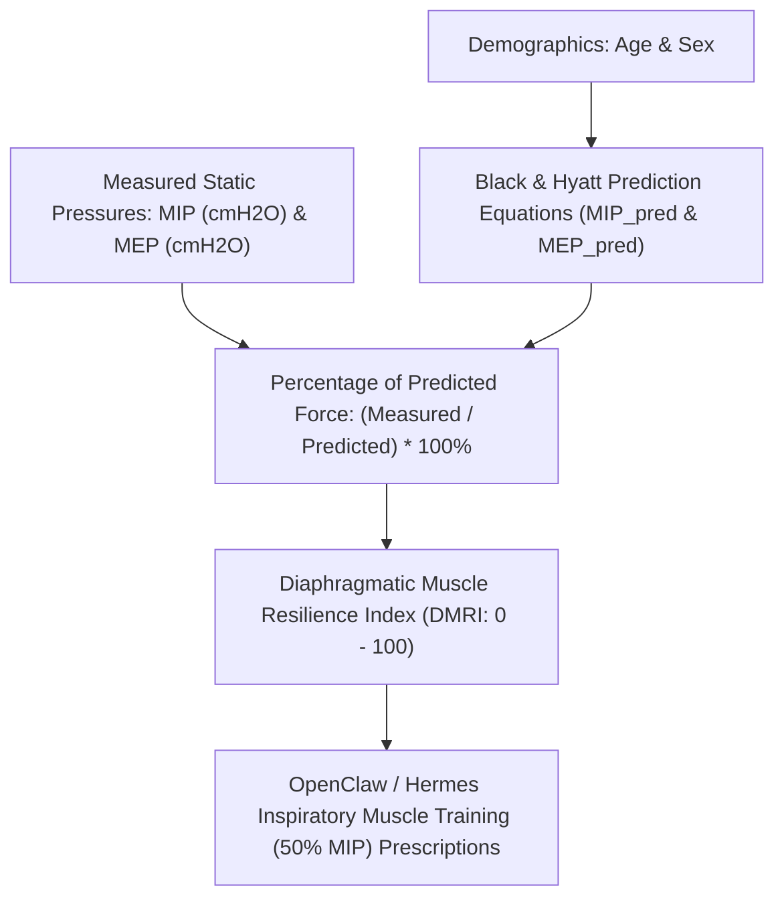

# Respiratory Muscle Strength (MIP/MEP) Skill

[](https://opensource.org/licenses/MIT)
[](https://www.python.org/downloads/)
[](https://github.com/alphaparkinc/genpark-personal-agent-respiratory-muscle-strength-mip-mep-skill)
[](https://github.com/alphaparkinc/genpark-personal-agent-respiratory-muscle-strength-mip-mep-skill)
[](https://modelcontextprotocol.io/)

A sovereign personal agent capability for computational respiratory physiology, evaluating Maximal Inspiratory (MIP) and Expiratory (MEP) Pressures in cmH2O, Black & Hyatt models, and diaphragmatic pump strength.

## Architecture



## Quickstart

```python
from client import RespiratoryMuscleStrengthClient

client = RespiratoryMuscleStrengthClient()

# Assess respiratory pressures (32-year-old male)
res = client.evaluate_respiratory_pressures(
    measured_mip_cmh2o=132.0,
    measured_mep_cmh2o=245.0,
    age_years=32.0,
    is_female=False
)

print("MIP % Predicted:", res["pct_predicted_mip"], "%")
print("MEP % Predicted:", res["pct_predicted_mep"], "%")
print("Resilience Score:", res["diaphragmatic_resilience_index"], "/ 100")
print("Status:", res["status"])
```

## MCP Server Integration

Add to your `claude_desktop_config.json` or OpenClaw tool registry:

```json
{
  "mcpServers": {
    "respiratory-muscle-strength": {
      "command": "python",
      "args": ["/path/to/genpark-personal-agent-respiratory-muscle-strength-mip-mep-skill/mcp_server.py"]
    }
  }
}
```

## License
MIT License.
